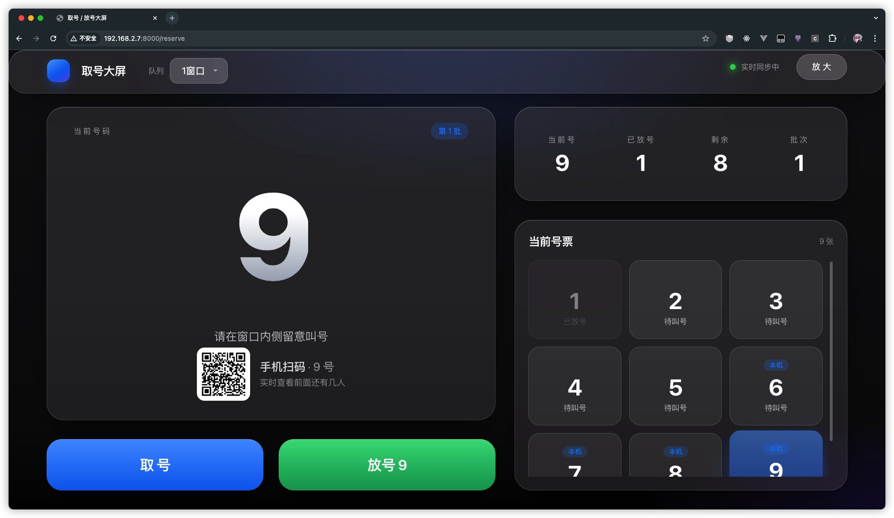
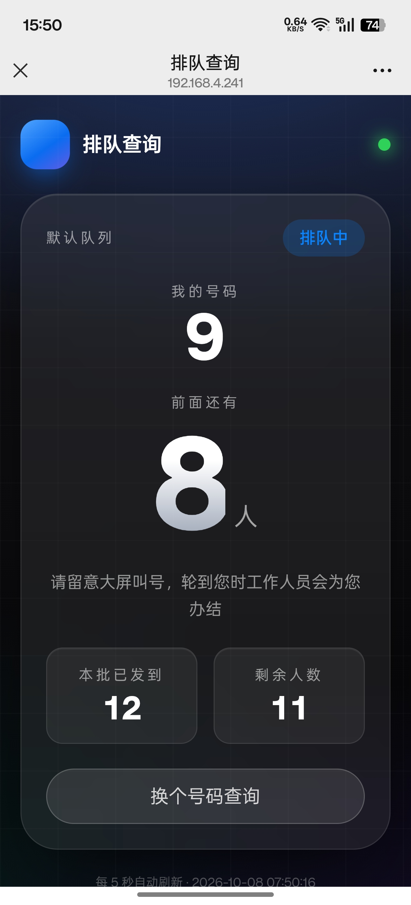
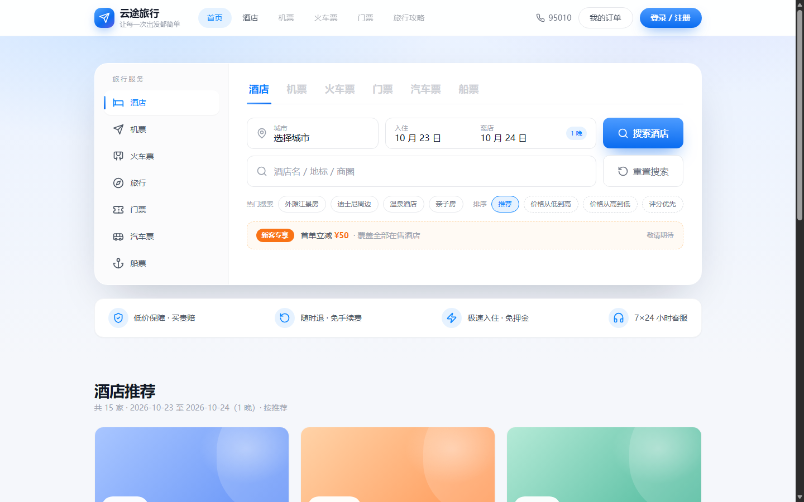
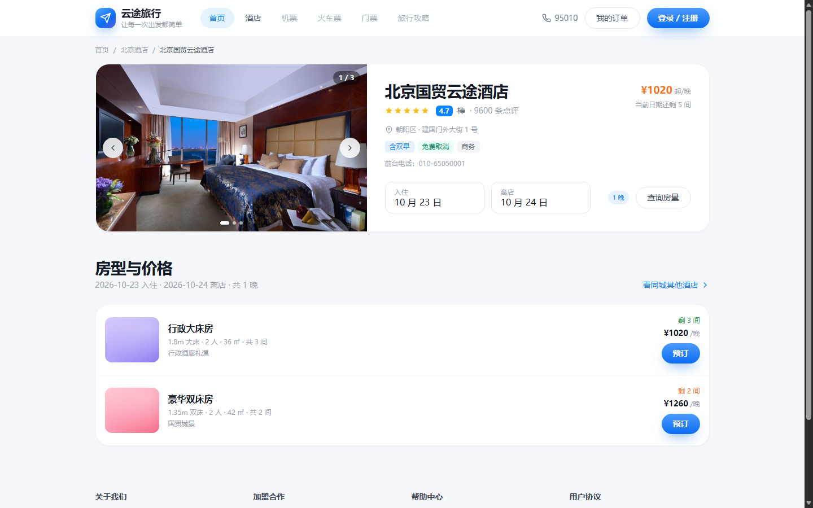

# ReserveApp · 预约取号系统 + 云途旅行酒店预订






基于 Laravel 的双模块应用：

- **预约取号**：轻量预约取号/放号系统，内置一个适合大厅大屏长期展示的**单页控制台**：超大号牌、取号/放号一键操作、队列状态实时轮询、本机号票管理。
- **云途旅行**（`/fly`）：酒店预订 C 端，顾客**无需登录**即可搜索酒店 → 选日期 → 看实时房量 → 下单 → 凭「订单号 + 手机号」查单/取消；后台 `/hotels` `/room-types` `/rooms` `/bookings` 维护酒店、房型、房间与订单。

## 功能特性

### 预约取号

- **取号** `POST /api/reserve`：传入队列标识 `key`，返回 `{queue_key, batch_no, serial_no}` 三元组
- **放号** `DELETE /api/reserve`：传入 `key + batch_no + serial_no`，释放一个号；全部放完后自动进入换批流程
- **状态查询** `GET /api/reserve/state`：大屏每 5 秒轮询，展示当前号/已放号/剩余/批次
- **批次状态机**：某批次 `active_count` 归零 → 标记 `need_reset` → 下次取号自动开启新批次（批次号单调递增）
- **大屏控制台** `/reserve`：号牌大字随视口高度自适应、取号弹跳动画、号票网格 + 内部滚动、放大/全屏模式、断线退避重连、toast 反馈
- **移动端查号** `/m`：扫码直达，只读查询「前面还有几人」，同样 5 秒轮询
- **多队列**：顶栏下拉切换，队列列表由 `config/reserve.php` 或环境变量 `RESERVE_QUEUE_OPTIONS` 配置
- 号票记录存于浏览器 localStorage（带版本号），刷新页面后仍可放号；界面只展示**当前批次**的号票

### 云途旅行（/fly）

- **酒店搜索**：城市 / 关键词（名称·商圈·地址·标签）/ 四种排序 / 分页，房量与起价实时计算
- **房型房量**：半开区间 `[check_in, check_out)` 库存口径，可订间数 = 未停用房间数 − 区间重叠订单占用；详情页支持**多图轮播**
- **下单**：游客可订（无需登录），金额/单价/晚数下单时快照；`idempotency_key` 唯一索引防双击重复下单
- **查单/取消**：凭「订单号 + 手机号」，取消是软状态（释放房量、历史可查）
- **渐进增强**：首屏纯 SSR，关掉 JS 全链路（搜索 → 详情 → 下单 → 查单 → 取消）仍可用；JS 只做搜索局部刷新与日期联动
- **后台管理**：酒店（多图上传）/ 房型 / 房间三级 CRUD + 订单列表/详情/取消（需登录）

## 技术栈

| 层 | 技术 | 版本 |
|---|---|---|
| 后端框架 | Laravel | 8.75（PHP ^7.3 \| ^8.0，实际运行 PHP 8） |
| 数据库 | MySQL（默认，见 `.env.example`）/ SQLite（可选，测试强制用它） | — |
| 前端模板 | Blade | — |
| 前端交互 | Alpine.js | ^3.4 |
| HTTP 客户端 | axios | ^0.21 |
| 样式 | Tailwind CSS | ^3.1 |
| 构建工具 | Laravel Mix（webpack 5） | ^6.0.6 |

> 注意：项目根目录的 `vite.config.js` 是遗留文件（引用的 `laravel-vite-plugin` 未安装），**构建一律走 Mix**。

## 快速开始

### 环境要求

- PHP >= 7.3（推荐 8.x），扩展：`openssl`、`pdo_sqlite`（或 `pdo_mysql`）、`mbstring`、`tokenizer`、`xml`、`curl`
- Composer 2.x
- Node.js >= 16 + npm

### 安装

```bash
# 1. 安装 PHP 依赖
composer install

# 2. 准备环境变量
cp .env.example .env
php artisan key:generate

# 3. 配置数据库（默认 MySQL，.env.example 已给出连接参数）
#    .env 中：DB_CONNECTION=mysql + DB_HOST/DB_PORT/DB_DATABASE/DB_USERNAME
#    想用零配置的 SQLite，改成：
#    DB_CONNECTION=sqlite
#    DB_DATABASE=/绝对路径/database/database.sqlite
touch database/database.sqlite   # 仅 sqlite 分支需要；文件已存在则跳过

# 4. 建表
php artisan migrate

# 5. 云途酒店图片上传依赖 storage 软链（必须）
php artisan storage:link

# 6. 安装前端依赖并编译
npm install
npm run prod        # 生产构建；开发时用 npm run watch 热更新

# 7. 启动
php artisan serve
```

访问：

- 大屏控制台：<http://localhost:8000/reserve>（需登录，首次先 `/register` 注册）
- 云途旅行 C 端：<http://localhost:8000/fly>（无需登录）
- 探活接口：<http://localhost:8000/api/health>

### 演示数据（可选）

仅 local 环境可灌入云途演示酒店/房型/房间：

```bash
php artisan db:seed --class=FlyDemoSeeder
```

### 多队列配置

`.env` 中用英文逗号分隔（默认只有一个「默认队列」）：

```env
RESERVE_QUEUE_OPTIONS="1号窗口,2号窗口,急诊"
```

## API 一览

统一返回 `{code, message, data?}`：`code:0` 成功、`code:1` 业务失败、422 参数校验失败、500 异常。

### 预约取号（写接口需登录）

| 方法 | 路径 | 入参 | 说明 |
|---|---|---|---|
| POST | `/api/reserve` | `key`（队列标识，必填） | 取号，成功返回 `{queue_key, batch_no, serial_no}` |
| DELETE | `/api/reserve` | `key`、`batch_no`、`serial_no` | 放号；`code:1` 表示号不存在或重复放号 |
| GET | `/api/reserve/state` | `key`（query） | 查询队列状态：`batch_no / current_no / released_total / remaining / need_reset` |
| GET | `/api/reserve/position` | `key`、`serial_no`（query） | 移动端查排队位置：`waiting / finished / not_found` + `ahead_count` |
| GET | `/api/health` | — | 探活 |

### 云途旅行（全部只读、公开）

| 方法 | 路径 | 入参 | 说明 |
|---|---|---|---|
| GET | `/api/fly/cities` | — | 城市清单 + 各城在售酒店数 |
| GET | `/api/fly/hotels` | `city` `q` `check_in` `check_out` `sort` `page` | 酒店卡片分页（含实时房量与起价） |
| GET | `/api/fly/hotels/{hotel}/room-types` | `check_in` `check_out` | 单酒店房型列表 + 各房型可订间数 |
| GET | `/api/fly/bookings` | `phone`（`order_no` 可选） | 按手机号查订单（脱敏输出） |

> 下单 / 取消是 Web 表单（`POST /fly/bookings`、`POST /fly/orders/{booking}/cancel`，`@csrf` + redirect），不暴露 C 端写 JSON 接口。

## 业务规则（批次状态机）

1. 取号时在同一队列、当前未办结批次（`need_reset = 0`）上 `current_no + 1`，`active_count + 1`。
2. 放号使 `active_count` 归零 → `need_reset = 1`，此后取号会开新批次（`batch_no` 取历史最大 + 1），号码重新从 1 开始。
3. 号的唯一性由 `(queue_key, batch_no, serial_no)` 三元组保证。
4. 状态查询接口刻意不加锁、不开事务，避免与高频率轮询互相阻塞。

## 云途库存口径

```
可订间数 = 该房型未停用房间数 − Σ room_count（有效订单 且 日期区间重叠）
```

- 入住/离店是**半开区间** `[check_in, check_out)`：入住当天算一晚、离店当天不算，相邻订单天然不冲突。
- 「有效订单」= 已预订 / 已入住；取消是软状态（`status=2`），行不删、房量立即释放。
- 库存 SQL 唯一出处：`app/Services/Fly/StockSql.php` 与 `AvailabilityService`，Controller 不重写重叠条件。
- 首页一次搜索恒定 5 条 SQL（分页 2 + 房型 1 + 可售聚合 1 + 占用聚合 1），与本页酒店数无关。

## 目录结构速览

```
app/Http/Controllers/Api/ReserveController.php   # 取号 / 放号 / 状态查询 / 排队位置
app/Http/Controllers/Api/FlyReadController.php   # 云途 4 条只读 JSON 接口
app/Http/Controllers/FlyHomeController.php       # /fly 首页（SSR）
app/Http/Controllers/FlyHotelController.php      # 酒店详情（SSR）
app/Http/Controllers/FlyBookingController.php    # 下单页 / 下单写接口（Web 表单）
app/Http/Controllers/FlyOrderController.php      # 手机号查单 / 订单详情 / 取消
app/Http/Controllers/HotelController.php         # 后台酒店 CRUD（多图上传）
app/Http/Controllers/BookingAdminController.php  # 后台订单管理
app/Services/Fly/StockSql.php                    # 库存 SQL 唯一出处
app/Services/Fly/AvailabilityService.php         # 房量聚合 + 下单房间分配
app/Services/Fly/HotelSearchService.php          # 搜索 / 分页 / 排序 / 卡片载荷
app/Models/Booking.php                           # 订单（日期区间 + 快照金额）
config/reserve.php                               # 队列选项配置
config/fly.php                                   # 云途 C 端参数（时区/分页/上限）
resources/views/reserve/                         # 大屏 Blade 视图（index + partials）
resources/views/mobile/                          # 移动端查号视图
resources/views/fly/                             # 云途 C 端视图（SSR + Alpine live 成对 partials）
resources/js/reserve/                            # 大屏前端分层：config / api / store / storage / app
resources/js/mobile/                             # 移动端前端（只读）
resources/js/fly/                                # 云途前端（渐进增强，整层无写请求）
resources/css/app.css                            # Tailwind + 组件类（m-* / fly-*）
routes/api.php                                   # API 路由
routes/web.php                                   # 页面路由 + 写接口（含 CSRF）
database/seeders/FlyDemoSeeder.php               # 云途演示数据（仅 local）
tests/Feature/ReserveStateTest.php               # 取号状态链路测试
tests/Feature/FlyAvailabilityTest.php            # 库存口径 / 搜索测试
```

面向 AI 智能体与协作者的完整规范（编码约定、前端分层、接口契约、常见坑位）见项目根的 **[AGENTS.md](./AGENTS.md)**。

## 测试

```bash
php artisan test                  # 或 ./vendor/bin/phpunit
php artisan test --filter=ReserveStateTest        # 取号链路
php artisan test --filter=Fly                     # 云途全部（库存/下单/查单/后台）
```

测试强制使用 sqlite `:memory:`（见 `phpunit.xml`），所有 SQL 都要两种方言通用。

## 部署要点

1. `composer install --optimize-autoloader --no-dev`
2. `npm ci && npm run prod`
3. `php artisan storage:link`（云途酒店图片）
4. `php artisan config:cache && php artisan route:cache`
5. Web 服务器（Nginx/Apache）将域名指向 `public/` 目录
6. 生产环境务必 `APP_ENV=production`、`APP_DEBUG=false`、配置好 `APP_KEY`

数据库默认 MySQL（`.env.example`）；也可切到 SQLite 单机跑，改 `.env` 的 `DB_*` 即可，迁移文件无需改动。

## License

MIT
